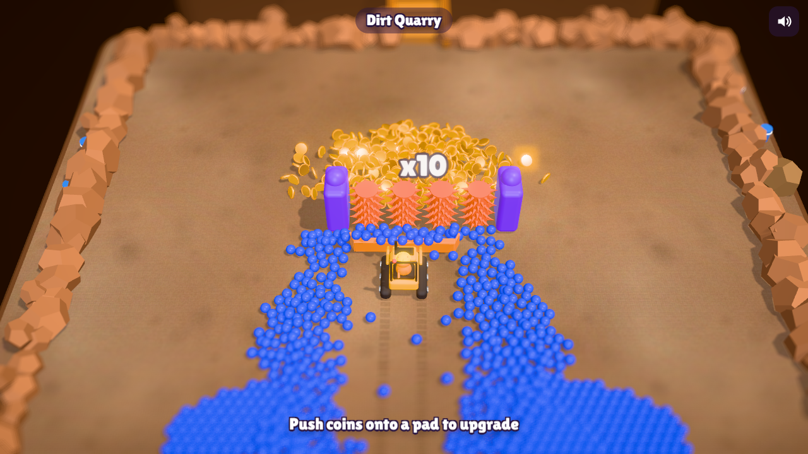

# 🐱🚜 PURRDOZER

> **Plow through oceans of gems with your bulldozer, crush them into avalanches of gold, and spend it all to get bigger.**
> Yes, it's the mobile game from the ads — and this time it's real.

### ▶️ [**Play it now in your browser**](https://abaudat.github.io/zombie-miner-clone/)

Desktop or phone — no install, no ads, no timers, no fail states. Just you, a cat in a hard hat, and thousands of physics-simulated marbles.



---

## The loop

1. **Plow** — drive into a field of hundreds of loose gems and shove as many as your blade can hold.
2. **Crush** — ram them into the spiked **multiplier crusher**. Every gem bursts into a spray of gold coins.
3. **Haul** — bulldoze the coin pile across the bridge.
4. **Spend** — push coins onto an upgrade pad. There's no wallet: your money is *physically on the ground*, and where you push it is what you buy.
5. **Get bigger** — wider blade, faster engine, bigger multiplier, wider bridges, conveyor belts… then build the bridge to the next zone.

## Five zones, each richer than the last

| | Zone | You're pushing | Worth |
|---|---|---|---|
| 🟤 | Dirt Quarry | Blue glass marbles | 1 |
| 🌋 | Lava Canyon | Glowing purple crystals | 10 |
| ❄️ | Ice Field | Chrome silver orbs | 100 |
| 🌿 | Jungle Ruin | Emerald chunks | 1,000 |
| 👑 | Treasure Vault | Solid gold nuggets | 10,000 |

At the end of the vault waits a giant **Golden Cat**. Fill it. See what happens. (~15–20 minutes.)

## Controls

| | |
|---|---|
| 📱 Phone | Touch anywhere and drag — floating joystick |
| ⌨️ Desktop | W/S drive forward/back, A/D turn (or arrow keys) — click-and-drag also works |

Progress is saved automatically in your browser.

## Languages

English · Español · Français · 日本語 · 简体中文 · 繁體中文

## Under the hood

- **Three.js**, zero build step — plain ES modules served straight from GitHub Pages.
- A **custom position-based sphere solver** with a spatial hash, sleeping bodies, inter-particle friction and a "grippy" blade, so thousands of gems actually pile, roll and avalanche.
- **Real rigid-body coins** ([Rapier](https://rapier.rs)): every coin is a disc that flips, rolls on its edge and stacks, in five tiers from bronze to royal purple. Resting coins freeze into static bodies until the dozer disturbs them, which keeps hundreds of them cheap.
- Instanced rendering for every gem and coin, PBR materials with environment reflections, realtime shadows, and a post-processing stack (bloom, tilt-shift "miniature" blur, color grade) for that glossy toy-diorama look.
- **100% procedural**: all models, textures, sound effects and music are generated in code.

## Run locally

```sh
python -m http.server 8000
# open http://localhost:8000
```

Design docs live in [`spec/`](spec/). Purrdozer is an original game inspired by the "bulldozer pushing balls" mobile ad genre; it uses no names, characters or assets from any existing game.
